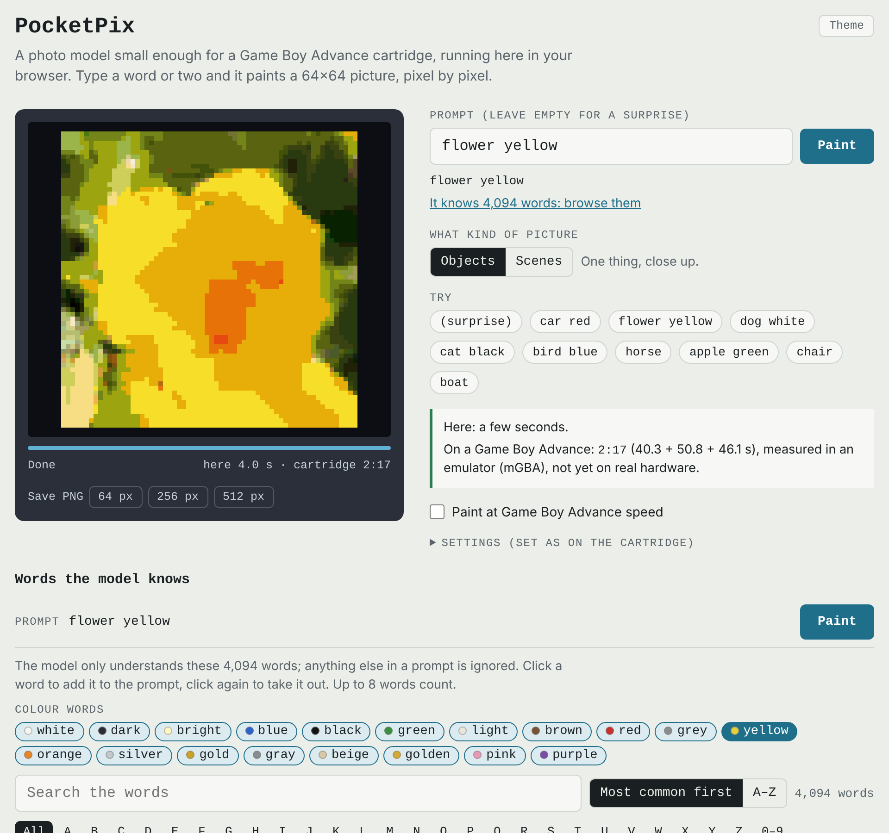

# Pocket Pix: a text-to-picture model on a Game Boy Advance cartridge

Type a word or two on a Game Boy Advance and it paints a 64x64 picture in 256 colours, pixel by pixel, with no
outside help: four small picture models (25 MB in all) and the integer engine that runs them fit in one 26 MB ROM.
The same C engine is compiled for the GBA, natively (as the reference the ROM is tested against) and to WebAssembly
for the browser version, which paints exactly what the native engine paints.

**Play in the browser:** https://rdsilver.itch.io/pocketpix

*Screenshots here and in img/web/itch_page/ were taken from earlier builds: the cartridge times they show (for
example 2:17 and 2:13) are older and slower than the current ones (img/web/gba_times.json).*

## Playing
* **Emulator:** open [build/pocketpix.gba](build/pocketpix.gba) in a GBA emulator. It has been tested in mGBA only.
  A picture takes about 1:20 to 2:00 there, just under two minutes on average (three passes: a 16x16 picture,
  then enlarged to 32x32 and 64x64; img/web/gba_times.json).
  Times have not yet been measured on real hardware.
* **Real hardware:** the ROM header's Nintendo boot-logo area is deliberately left blank (no Nintendo data is
  included), so a console's own boot check will not start it; loaders that do not need the logo may. Untested.
* **Browser, offline:** unzip [img/web/pocketpix-web.zip](img/web/pocketpix-web.zip) and serve the folder over HTTP
  (for example `python3 -m http.server` inside it), then open index.html. The page loads its two model files
  (pix0.bin, pix1.bin) from the same folder and contacts nothing else.

Controls on the cartridge: pick letters to build a word, L/R to choose among the matching words, A to press,
B to delete; up to 8 words. START paints (an empty prompt paints a random picture), SELECT switches
between the *objects* model (one thing, close up) and the *scenes* model. Finished pictures can be kept in the
gallery (7 slots in the cartridge's save memory). The model knows 4,094 words (img/remote/night/words.json).

## How it works
* **Model** (img/model.py): a picture is S x S palette pixels written cell by cell (C x C pixels per cell). A *body*
  runs once per cell (ternary matrices, 1-bit-key top-k attention, a running-average mixer, MLP blocks; the building
  blocks come from Koko's train/model.py), and a tiny *head* runs once per pixel, scoring 16 colour groups and then
  the 16 colours of the chosen group. Prompts are up to 8 word ids; guidance mixes the prompted and unprompted scores.
* **Chain** of four models in build/pix.bin: b16C (16x16 base, objects), u32M (16 -> 32 enlarger), u64M (32 -> 64
  enlarger) and b16O (16x16 base, scenes). Each enlarger paints over the thumbnail the pass before it made.
* **Engine** (pix/pix.c + ARM kernels in pix/kernels.s): integer only, Q12 fixed point, lookup-table kernels for the
  ternary matrices, plus a few switchable approximations measured against the PyTorch model (early exit in the first
  MLP matrix, per-layer thresholds, copying flat cells from the thumbnail). [pix/DESIGN.md](pix/DESIGN.md) is the
  full engineering log, with every speed and quality measurement.
* **Native twin** (host/pix_twin.c) and **WebAssembly** (web_wasm/pixwasm.c) build the very same pix/pix.c.

## Building and testing
Needs: Python 3 with NumPy, PyTorch (CPU is enough) and Pillow; gcc; arm-none-eabi-gcc; libmgba (headers and
library, for the emulator tests); clang with the wasm32 target and wasm-ld (browser build); Node.js (optional JS test).
Run everything from the repository root.

    python3 -m pix.export b16C u32M u64M b16O        # weights -> build/pix.bin + gen/pix_layout.h (byte-identical to the shipped ones)
    python3 pix/build_game.py                        # build/pocketpix.gba (byte-identical to the shipped ROM)
    gcc -O2 -Wall -Igen -o build/pix_twin host/pix_twin.c pix/pix.c -lm      # native twin
    gcc -O2 -Wall -o build/runner test/runner.c -lmgba                         # headless mGBA driver
    python3 pix/test_gba.py                          # test ROM in mGBA: picture must equal the twin's; prints cycles per model
    python3 -m pix.check b16C u32M u64M b16O build/pix_test48.u8   # integer engine vs PyTorch (bits/pixel, KL), a few minutes on CPU
    python3 -m img.tests                             # model unit checks (causality, probabilities, sampling)
    python3 img/web/build.py                         # browser build: img/web/itch/, img/web/artifact/, img/web/pocketpix-web.zip

The twin paints pictures directly: `build/pix_twin build/pix.bin paint <seed> <guide_q8> <inv_temp_q8> <n> [word ids...]`
writes n pictures of 64x64 palette indices to stdout (palette: img/remote/pal/p16o.npy; word ids index words.json),
for example `build/pix_twin build/pix.bin paint 12345 768 284 1 14 5 > pic.u8`.

`pix/test_gallery.py` still describes the old 15-slot flash save layout and needs updating before it is used again
(see pix/DESIGN.md, "Gallery"). tools/ holds the measurement scripts used while tuning the engine (quality sweeps,
early-exit calibration, contact sheets); their docstrings say how to run them, and several need caches or dumps made
by pix/qc.py first.

The older JavaScript engine (img/web/engine.js, no longer used by the page, which runs the WebAssembly build) can
be checked against PyTorch with Node.js, for example on b16C:

    python3 -m img.web.export img/remote/night/b16C.pt img/remote/night/b16C.json /tmp/b16C.bin
    python3 -m img.web.ref img/remote/night/b16C.pt img/remote/night/b16C.json /tmp/b16C
    node img/web/test_engine.js /tmp/b16C.bin /tmp/b16C

## Training
img/ holds the training code; the datasets are not included (see CREDITS.md for what was used).
* img/data.py turns a picture collection into palette-indexed training files (CommonCatalog CC-BY:
  `python3 -m img.data --wds data-archetype/commoncatalog_cc_by_3m_512 ...`), img/caps.py adds prompt words from the
  captions, img/thumbs.py makes thumbnail sets, and img/oi.py adds Open Images close-up crops
  (`python3 -m img.oi pick`, `fetch`, `build o 0.15`).
* img/train.py trains one model: `python3 -m img.train --set name=... data=... key=value ...`. The full configuration
  of each shipped model (sizes, learning rate, steps, data set) is in its img/remote/night/<name>.json.
  img/setup_box.sh and img/launch.py prepare and run training on a GPU machine.
* img/chain.py draws pictures through a chain of trained models in PyTorch.

Rebuilding the exact training sets from scratch takes several of these steps in turn and a large download; it is
not a one-command job.

### Experimental: distillation from FLUX.1-schnell
img/DISTILL.md describes a trial that fine-tunes the cartridge models on clean pictures drawn by FLUX.1-schnell
(img/distill.py, img/flux_gen.py, img/jobs/x_*.sh). It needs several large GPUs. Its results are not in the ROM and
its weights are not published here.

## Layout
| Path | What is in it |
|---|---|
| build/pocketpix.gba | The playable ROM |
| build/pix.bin | The cartridge's model file (all four models), built by pix/export.py |
| build/pix_test48.u8 | 48 model-painted 64x64 test pictures used by the quality checks |
| pix/ | Cartridge engine (pix.c, pix.h, kernels.s), game (game.c), startup and linker script, exporter, checks, emulator tests, DESIGN.md |
| host/pix_twin.c | Native build of the engine: the reference the ROM and the browser are tested against |
| web_wasm/pixwasm.c | WebAssembly wrapper around pix/pix.c |
| gen/ | Generated headers: pix_layout.h (blob layout, from pix/export.py), font.h (from tools/font.py) |
| img/ | Picture model, training and data tools; img/web/ the browser page and its build; img/jobs/ distillation jobs |
| img/remote/night/ | The four shipped models (PyTorch weights + configs) and the word list |
| img/remote/pal/p16o.npy | The 256-colour palette (15-bit GBA colours) |
| img/web/pocketpix-web.zip | The browser version, ready to upload or serve |
| img/web/itch/ | Credits shipped with the browser version, including per-photo Open Images credits |
| img/web/itch_page/ | Cover image, screenshots and a 33-second trailer (pocketpix-trailer.mp4) |
| train/ | Model building blocks shared with Koko the Chatbot (QLinear, quantisation, attention, MLPs) |
| test/ | Headless mGBA programs: runner (tests), prof (per-instruction cycle profile), trace |
| tools/ | fixrom.py (ROM padding and header checksum), font.py, engine tuning and measurement scripts |
| dl/font/ | font8x8 source (public domain) |

## Credits and licence
Program code: MIT ([LICENSE](LICENSE)). Model weights: CC BY 4.0 ([LICENSE-MODEL](LICENSE-MODEL)).
Training data, font and third-party credits: [CREDITS.md](CREDITS.md).
Game Boy Advance is a trademark of Nintendo; this is an unofficial hobby project, not made or endorsed by Nintendo.
